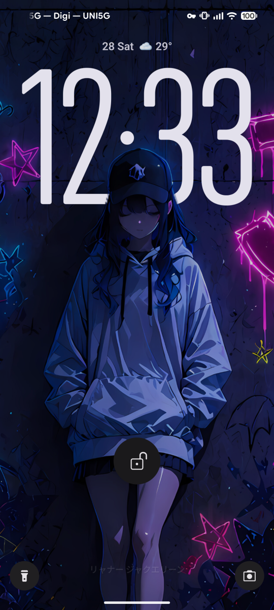
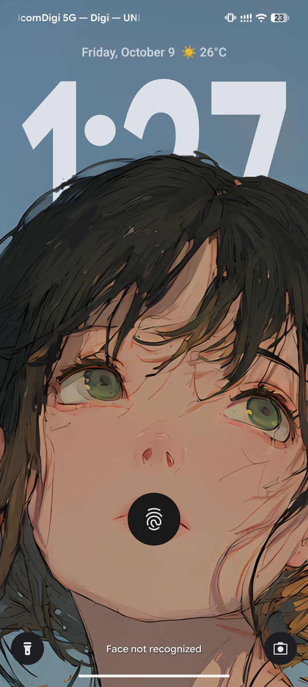
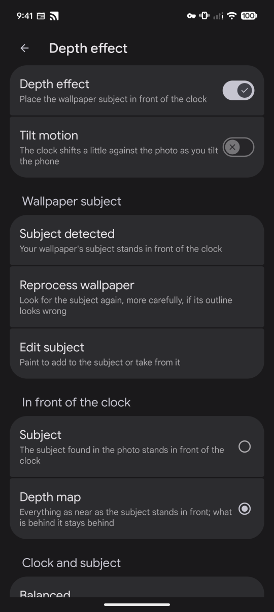

# Pixel Lock Screen Evolved

**The lock screen clocks and depth effect the Android 17 Pixel does not ship, picked where you already choose one.**

## Features

- **Eight clock styles** in Wallpaper & style → **Clock**, beside Google's own: iOS, Hyper, Headline, Poster, One, Horizon, Dot and Cinema, each with Google's Style, Color and Size tabs and its own small face.
- **Clock width, size and position:** the iOS width cuts, a size slider for every style, adaptive size, and a Position tab to drag the clock, snap it or turn it up to 90°.
- **Depth effect:** the photo's subject stands in front of the time, found on the device. Optionally refined by a depth map, editable with a brush, and the time comes forward when it would be hard to read. It works with Google's clocks too.
- **Always-on display:** keep the lock screen photo, in colour, greys or sparse dots of a size you choose.
- **Double tap** an empty space on the lock screen to turn the screen off.
- **Compatibility & diagnostics:** every host member checked on the phone before anything installs, per-feature fallbacks, and Safe Mode after repeated crashes.

Every setting, with screenshots: [features](docs/features.md).

## Install

1. Get the APK from [Releases](https://github.com/MrxSiN/PixelLockScreenEvolved/releases).
2. Enable it in [Vector](https://github.com/JingMatrix/Vector) or any framework implementing libxposed API 102. Its scope (System UI and Wallpaper & style) is set for you.
3. Restart System UI and force-stop Wallpaper & style once.
4. Wallpaper & style → **Clock** → choose a clock → Apply. Optionally, Lock screen → **Depth effect**.

Needs a Pixel on Android 17 QPR1 (API 37), and root for the framework. The module has no icon or screen of its own: every control is in Wallpaper & style.

## Compatibility

| Build | Android | Status |
|---|---|---|
| `CP4A.261105.040.A1` | 17 QPR1, November 2026 | ✅ Verified; every contract checked in CI, three renamed members found with DexKit |
| `CP3A.261005.005` | 17 QPR1, October 2026 | ✅ Verified |
| `CP3A.260905.009` | 17 QPR1, September 2026 | ✅ Verified |
| `CP2A.260805.005` | 17, August 2026 | ✅ Verified |

Tested on a Pixel 8 Pro with Vector 2.2. Monthly builds rename SystemUI's internal members. The module finds them again by what they are, and switches a feature off rather than guess when it can't; the rest keep working. History: [changelog](CHANGELOG.md).

## Known limits

- Live wallpapers are drawn by their own apps, so they have no depth effect.
- Finding a new photo's subject takes about 12 seconds, once (about 23 with the depth map).
- Every feature is checked on one phone, a Pixel 8 Pro.

## Troubleshooting

| Problem | Try |
|---|---|
| A clock or the depth effect is missing | Wallpaper & style → Lock screen → **Compatibility & diagnostics** shows which feature is off and why. |
| The subject's outline is wrong | Depth effect → **Reprocess wallpaper**, or **Edit subject** to paint it. |
| System UI keeps crashing | Safe Mode turns the module off after three crashes in a minute; restore it from its notification once the cause is fixed. |
| Anything else | Disable the module and restart System UI: the lock screen falls back to the default clock. |

More: [recovery](docs/features.md#recovery).

## How it works

Most lock screen modules draw a clock over SystemUI's and hide the real one. This one adds its clocks to SystemUI's own clock registry, so SystemUI lays them out, dims them for the always-on display, moves them for burn-in and previews them itself, and Wallpaper & style lists and stores them like any clock. Every host member a feature needs is declared as a contract, checked before anything installs, and checked in CI against each verified Pixel build. The depth effect's models run in the module's own app, on the device.

[Architecture](docs/architecture.md) · [depth effect](docs/depth-effect.md) · [all docs](docs/README.md) · [`HOOK_NOTES.md`](HOOK_NOTES.md)

## Support

If the module is useful to you, you can [sponsor its development](https://github.com/sponsors/MrxSiN).

## Credits and license

[libxposed](https://github.com/libxposed/api), [Vector](https://github.com/JingMatrix/Vector),
[DexKit](https://github.com/LuckyPray/DexKit), [ONNX Runtime](https://onnxruntime.ai),
[BiRefNet](https://github.com/ZhengPeng7/BiRefNet) (MIT),
[Depth Anything V2](https://github.com/DepthAnything/Depth-Anything-V2) (Apache 2.0),
[Inter](https://github.com/rsms/inter) (OFL 1.1) and AXS66Clock, distributed with permission.

GPL-3.0. See [LICENSE](LICENSE) and [NOTICE](NOTICE.md).
This project is not affiliated with Google or Apple.
