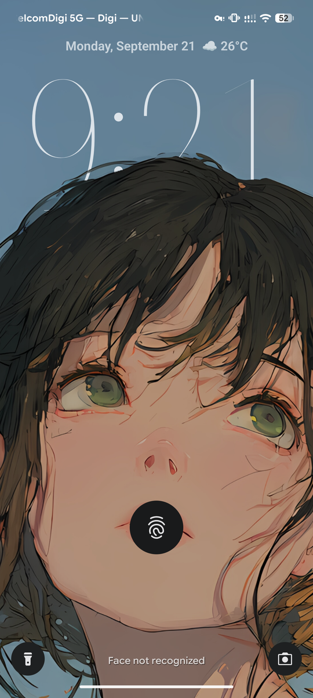
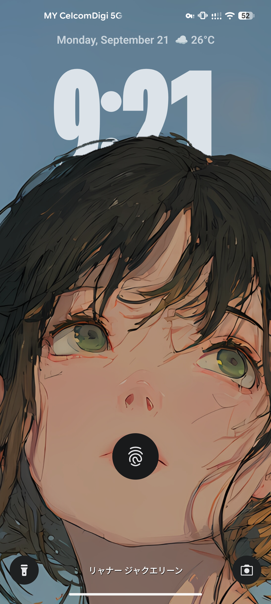
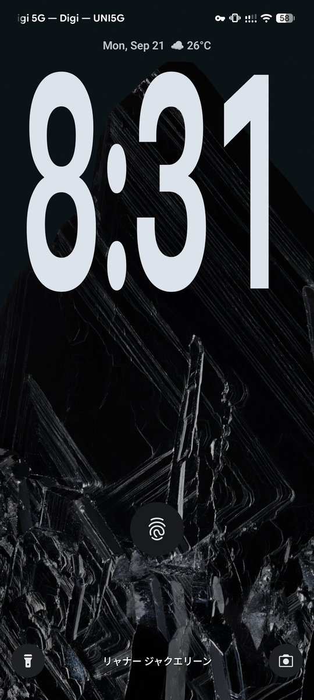
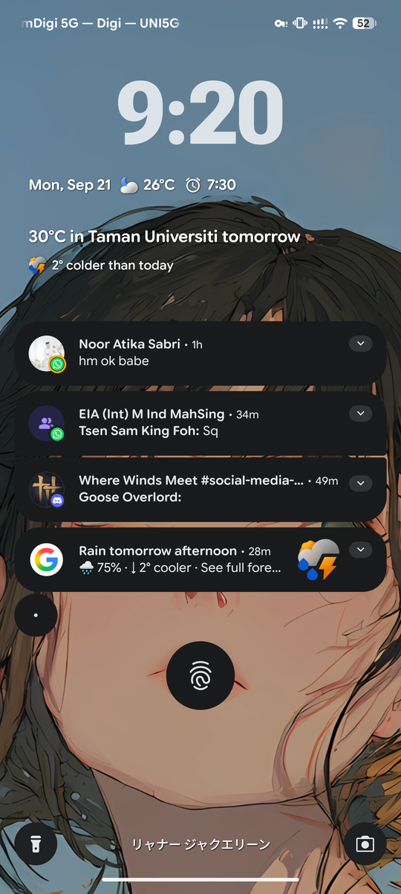
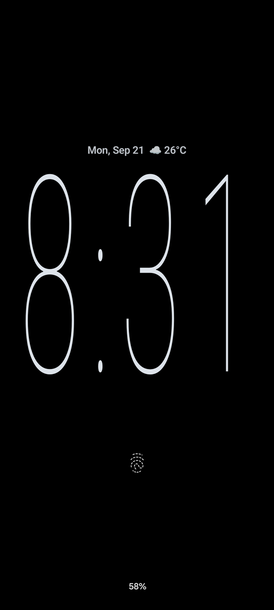
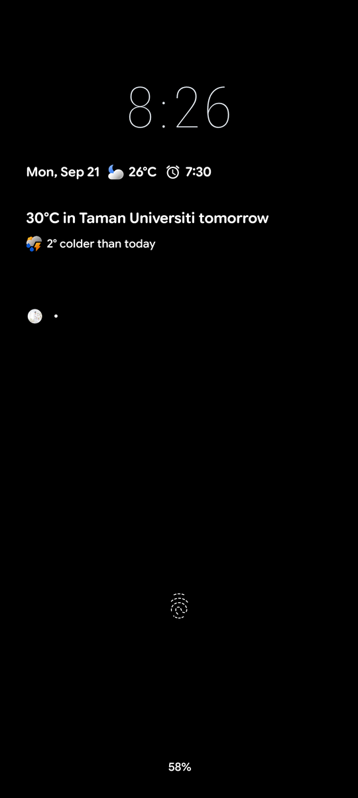

<div align="center">


# Pixel Lock Screen Evolved

**The lock screen clocks and depth effect the Android 17 Pixel does not ship — picked where you already choose one.**

Wallpaper & style → **Clock** → iOS, Stacked, Numerals, Analog or Split, beside Google's own.

<br>

[](https://github.com/MrxSiN/PixelLockScreenEvolved/releases)
[](https://github.com/MrxSiN/PixelLockScreenEvolved/releases)
[](https://developer.android.com)
[](LICENSE)

</div>

---

> [!NOTE]
> **v0.0.5 is fully compatible with the latest Android release: Android 17 QPR1
> (September 2026, `CP3A.260905.009`), tested on a Pixel 8 Pro.** QPR1 moved the
> lock screen into a Compose scene and dropped a number of older clock APIs;
> every feature in this module runs on that scene, and the compatibility report
> in Wallpaper & style shows each hook it depends on resolving on your own build.

## Why it works this way

Most lock screen modules draw a clock over SystemUI's and hide the real one.
This one does not. Its clocks are added to SystemUI's own clock registry, the
same place Google's clocks come from, so SystemUI lays them out, dims them for
the always-on display, moves them for burn-in and previews them itself — and
Wallpaper & style lists them, previews them and stores the choice as it does
for any clock.

|  | |
|---|---|
| 🎯 **Native** | Chosen, previewed and applied in Wallpaper & style. No settings app, no second preview. |
| 🌗 **Everywhere a clock is** | The lock screen, the picker preview and the always-on display, following the wallpaper's colours. |
| 🔙 **Leaves nothing behind** | Nothing is written but the clock choice the picker itself stores. Disabling the module falls back to the default clock. |
| 🧩 **One contract** | A clock style knows nothing of SystemUI; `host/` adapts any `ClockStyle` to SystemUI's clock plugin interfaces. |
| 🛟 **Fails softly** | Every hook belongs to one feature. A feature whose host API moved switches itself off and says so; the rest keep working. Repeated crashes turn on Safe Mode rather than leaving you with a lock screen you cannot use. |

---

## Features

<details open>
<summary><b>🕘 Five clock styles</b></summary>
<br>

Each is a full Wallpaper & style clock, with Google's own **Style**, **Color**
and **Size** tabs, its own thumbnail in the clock list, and its own small face
for when notifications share the screen.

| Style | Large face | Small face |
|---|---|---|
| **iOS** | The date over a large, centred time. 12-hour time without AM/PM or a leading zero; 24-hour time padded. | The time alone, with Pixel's date and weather row below. |
| **Stacked** | Hour over minute, flush to the start of the screen, date below. | One line. |
| **Numerals** | Giant Roboto Flex figures whose minute grows heavier and wider as the hour passes. | One line. |
| **Analog** | A dial with rounded hands, the date below. Its ticks fade and its hands go to outline on the always-on display. | A small dial. |
| **Split** | One heavy line drawn down the screen, stretched until it meets the photo's subject. | One line, taller than a Pixel small clock's. |

Every large face writes its own date where its design puts it, so SystemUI's
date and weather row is left out beside it rather than shown twice.

</details>

<details open>
<summary><b>📐 Clock face width and size</b></summary>
<br>

The picker's own two sliders, in the tabs Google puts them in. Every style has
the size slider; the iOS clock has the width slider as well.

| Control | Where | What it does |
|---|---|---|
| **Clock face width** (iOS) | Clock → Style | The same seven cuts Google's flex clock steps through, read from its own presets: `wght` 200 at `wdth` 120 through to `wght` 800 at `wdth` 30, widest and lightest first. The numerals grow heavier as they narrow, so every stop keeps about the same ink on screen. |
| **Clock size** | Clock → Size | Six steps, each taller than the last, in place of the Large switch. Moving the slider alone enables Apply. |

Every width of one size is the same height: the size is chosen at the point the
widest cut fits the screen, so a narrower stop draws a narrower time rather
than the same block of screen in a different cut.

<table>
<tr>
<td align="center"><br><sub>iOS at the first stop: <code>wght</code> 200, <code>wdth</code> 120</sub></td>
<td align="center"><br><sub>iOS at the last stop: <code>wght</code> 800, <code>wdth</code> 30</sub></td>
</tr>
</table>

</details>

<details open>
<summary><b>🪄 Depth effect</b></summary>
<br>

The subject of a photo wallpaper in front of the large clock, as on iOS: the
time goes behind the subject, and nothing else on the lock screen does. Where
the subject would hide more than half of the time, the time stays in front so
it can still be read. The lock screen tab of Wallpaper & style shows the effect
too; the preview of a photo not yet set does not.

Wallpaper & style → Lock screen, at the bottom:

| Setting | Where | What it does |
|---|---|---|
| **Depth effect** | Its switch, or its page | Finds the subject of the lock screen photo on the device and draws it over the time, placed exactly where the window manager puts the wallpaper and following its scroll, zoom and dimming. |
| **Reprocess wallpaper** / **Try again** | Depth effect page | Shows whether the subject was found, and looks again, more carefully (the photo and its mirror image, averaged), when the outline came out wrong or none was found. No app data needs clearing. |

The subject is found once per photo, by the module's own app, with
BiRefNet_lite on ONNX Runtime; nothing leaves the device. It takes about 12
seconds on a Pixel 8 Pro, and a **Preparing depth effect** notification shows
meanwhile — silent, with its icon in the status bar — then **Depth effect
ready** for a few seconds. A photo already seen shows its effect at once. Live
wallpapers are drawn by their own apps and have no depth effect.

</details>

<details open>
<summary><b>✂️ Split: a clock that reads the photo</b></summary>
<br>

Split is drawn for the depth effect. The time is one heavy line stretched down
the lock screen until it meets the photo's subject, and a little past it, so
the subject stands in front of the ends of the numerals rather than beside
them. The subject's box is measured from the cut-out the depth effect already
made, placed exactly where the wallpaper is placed, and the face is laid out
around it again whenever the photo or its scroll changes.

A photo whose subject fills the screen from its top is a background rather than
something to stand the time above, so there the numerals reach toward the
middle of the screen instead — as they do when the depth effect is off or no
subject was found.

<table>
<tr>
<td align="center"><br><sub>Stretched to the subject</sub></td>
<td align="center"><br><sub>Beside notifications</sub></td>
<td align="center"><br><sub>On the always-on display</sub></td>
</tr>
</table>

</details>

<details open>
<summary><b>🌙 Always-on display</b></summary>
<br>

Wallpaper & style → Lock screen → **Always-on display**:

| Setting | What it does |
|---|---|
| **Show lock screen wallpaper** | Keeps the lock screen photo on the always-on display, dimmed, as on iOS. It needs **Always show time and info** on, and uses more battery than a black always-on display. |
| **Appearance**: Color, Black & white or Dots | One of three: the photo dimmed; dimmed in greys; or sparse dots on black, only the photo's subject where the depth effect found one, about 4% of pixels lit, for the least power. Each dot is lit nearly as brightly as the clock beside it, since the always-on display holds greys unsteadily. |

Going to sleep, the numerals thin along the font's weight axis rather than
fading, so few pixels stay lit, and the iOS clock is traced in outline. The
time comes out in front of the depth effect's subject first and only then gives
its place back to SystemUI's fingerprint-aware clock region, so nothing crosses
the subject midway. Everything shifts a little every minute, the photo on a
small circle and the dots through their grid, so no pixel stays lit, against
burn-in.

With notifications, the rows are spaced as SystemUI spaces its own: a small
module face is given the band the lock screen lays its own small clock out in,
so the date row and the notifications below it keep their distances.

<table>
<tr>
<td align="center"><br><sub>Notifications on the always-on display</sub></td>
</tr>
</table>

</details>

<details open>
<summary><b>🩺 Compatibility, diagnostics and Safe Mode</b></summary>
<br>

Wallpaper & style → Lock screen → **Compatibility & diagnostics**.

Every host class, method and field the module needs is declared up front, one
list per feature. On startup each is looked for and the result published as a
snapshot; the dialog shows, per feature, whether it is running, and which
contract moved when it is not.

| | |
|---|---|
| **Per-feature hooks** | A feature whose required contract is missing never installs its hooks. It switches itself off and logs why; clocks, the depth effect, the picker pages and smartspace placement each stand or fall alone. |
| **Verified builds** | The Android builds each feature has been run on, so a snapshot from an unverified build reads as untested rather than broken. |
| **Safe Mode** | Repeated crashes in a hooked process turn every hook off and post a notification, rather than leaving you with a lock screen or a picker you cannot use. Clearing it is one tap. |

</details>

---

## Status

**v0.0.5.** Fully compatible with **Android 17 QPR1 (September 2026)**, tested
on a Pixel 8 Pro (`CP3A.260905.009`). Hooks reach into SystemUI and Wallpaper &
style internals that can move between Android releases; when one moves, the
feature that needs it switches itself off and says so in **Compatibility &
diagnostics**, and the rest keep working.

Known limits:

- Live wallpapers are drawn by their own apps, so they have no depth effect.
- Finding a subject takes about 12 seconds per new photo, once.

## Requirements

| | |
|---|---|
| **Android** | 17 QPR1 (API 37) on a Pixel |
| **Apps** | System UI (`com.android.systemui`) and Wallpaper & style (`com.google.android.apps.wallpaper`) |
| **Framework** | [Vector](https://github.com/JingMatrix/Vector) v2.2+, or any framework implementing libxposed API 102+ |
| **Root** | Only what the framework itself needs |

Built against the modern [libxposed API](https://github.com/libxposed/api)
(`io.github.libxposed:api`), not the legacy `de.robv.android.xposed` bridge.

## Install

```
1. Install the APK from Releases
2. Enable Pixel Lock Screen Evolved in your Xposed manager
3. Restart System UI and force-stop Wallpaper & style once
4. Wallpaper & style → Clock → choose a clock (iOS, Stacked, Numerals, Analog or Split) → Apply
5. Optional: Wallpaper & style → Lock screen → Depth effect
```

The module declares a **static scope**, so there is nothing to pick. It has no
icon in the app drawer and no screen of its own: every control is in Wallpaper
& style.

---

## How it works

System UI and Wallpaper & style each build their own `ClockRegistry`. Just
before each registry reads which clock is chosen, the module adds its styles to
it, presented as an ordinary `ClockProvider`:

```
ClockStyle ──▶ host/ adapters ──▶ ClockProvider ──▶ SystemUI's ClockRegistry ──▶ lock screen, preview, AOD
                                                └──▶ Wallpaper & style's ClockRegistry ──▶ Clock list, sliders
```

From there each process treats them as its own. The width and size are axis
values in the clock setting the picker already writes, so choosing one keeps
the other and nothing else is stored.

<details>
<summary><b>Android 17 QPR1's Compose lock screen, in detail</b></summary>
<br>

QPR1 hosts each clock face inside a Compose scene, through an
`AndroidViewHolder`, and places that holder with graphics layers that no view
matrix carries. Anything drawn to line up with the screen — the depth effect's
subject over the wallpaper — therefore came out scaled and shifted. The
holder's own Compose coordinates are read instead, and the face is re-pinned
before every draw the scene moves anything in, so the clock never lands a frame
late. The date row and smartspace card, which the scene lays out above the
clock, are stacked back under it the same way.

</details>

<details>
<summary><b>The depth effect, in detail</b></summary>
<br>

SystemUI draws a still lock screen photo itself. Each time it draws one it has
not drawn before, the photo is taken as drawn, copied at the wallpaper
surface's size, and sent to the module's app, which finds the subject's mask
with BiRefNet_lite and answers only SystemUI. A mask already found is read back
from disk. The subject cut out of the photo becomes a layer beside the large
clock face, placed as `WallpaperController` places the wallpaper — crop, scroll
and zoom — erased from the time alone, left out while it would hide more than
half of the time's ink, and drawn as one layer with the face so whatever fades,
dims or darkens the photo does the same to the subject.

</details>

`HOOK_NOTES.md` records the SystemUI and Wallpaper & style internals each part
relies on, and how they were verified on a device.

---

## Build

```bash
./gradlew clean testDebugUnitTest assembleRelease
```

Vector hot reloads only when the installed `versionCode` differs from the code
already loaded in a host process. For iterative device builds, pass a new,
monotonically increasing value each time:

```bash
./gradlew assembleRelease -PmoduleVersionCode=8
```

`META-INF/xposed/module.prop` opts in with `autoHotReload=true`; the module hands
over each live host and rebuilds its current clock without restarting it.

A local release build is unsigned unless `ANDROID_KEYSTORE_PATH`,
`ANDROID_KEYSTORE_ALIAS`, `ANDROID_KEYSTORE_PASSWORD` and `ANDROID_KEY_PASSWORD`
are set. `scripts/check-project.sh` runs the static invariants that CI enforces,
and `PUBLISHING.md` describes the signed releases GitHub Actions builds.

Release builds are shrunk with R8; the module entry class is kept by name,
because the framework resolves it from `META-INF/xposed/java_init.list` rather
than from any call site.

## Design

```
PixelLockScreenEvolvedModule   Xposed entry: hands each process the patches it needs
clock/                         clock styles and faces; knows nothing of SystemUI
  parts/                       what every face shares: numerals, date line, digit roll, thumbnails
  styles/                      one file per design
host/                          adapters to SystemUI and Wallpaper & style, one patch per concern
hook/                          the hooking contract, over the libxposed API
diagnostics/                   host contracts, per-feature gating and the compatibility snapshot
safemode/                      crash-loop detection and the Safe Mode switch
depth/                         the app side of the depth effect: subject segmentation
motion/                        springs and the system's own animation timing
core/                          logging
```

Adding a style means implementing `clock.ClockStyle` and a `ClockFace` in
`clock/styles/` and listing the style in `clock.ClockStyles.all`. For a size
slider, set `isResizable` and make its faces `ResizableClockFace`; for the width
slider, set `isWidthAdjustable` and make its faces `AdjustableWidthClockFace`;
to lay a face out around the photo's subject, make it `SubjectAwareClockFace`.
Nothing in `host/` changes.

Every SystemUI clock plugin class is named in `host/ClockPluginApi.kt` alone,
and each other part of SystemUI in one `…Api` class, so a SystemUI update that
moves something is absorbed in one file.

---

<div align="center">

**GNU General Public License v3.0** · see [`LICENSE`](LICENSE) and [`NOTICE.md`](NOTICE.md)

</div>
