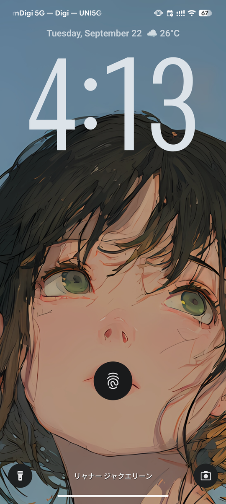
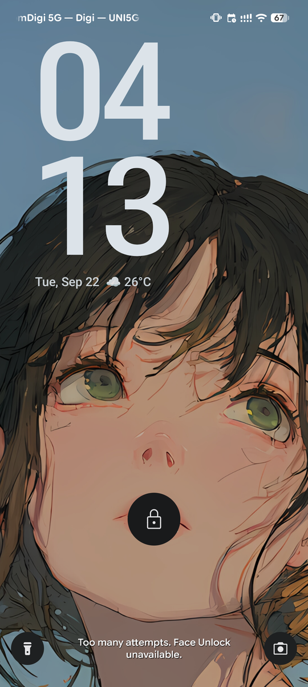
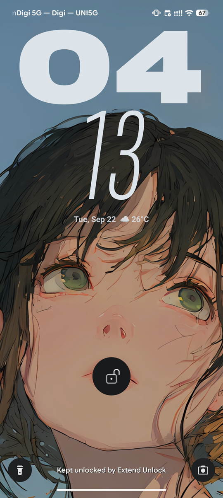
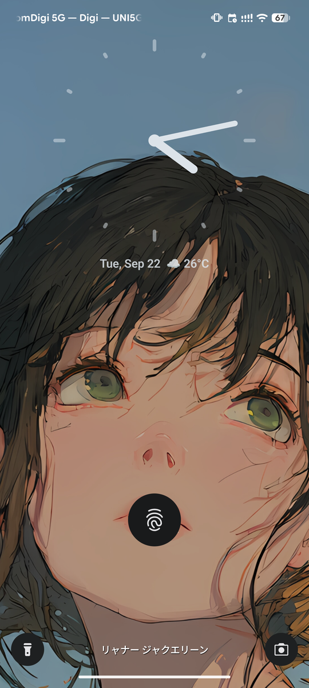
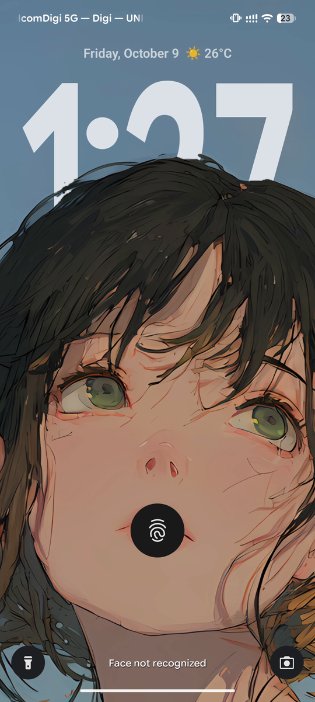
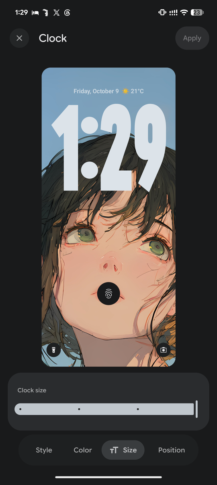
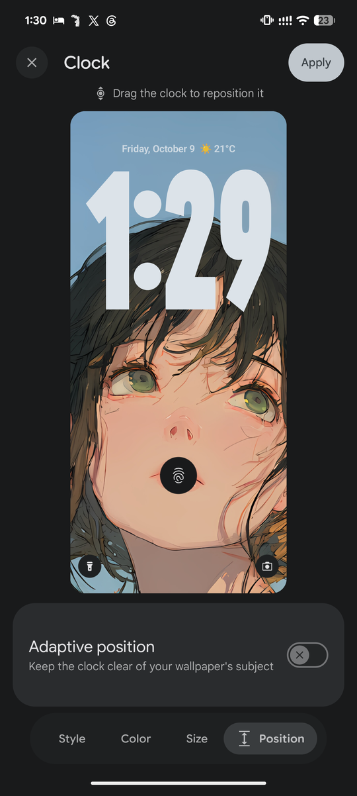
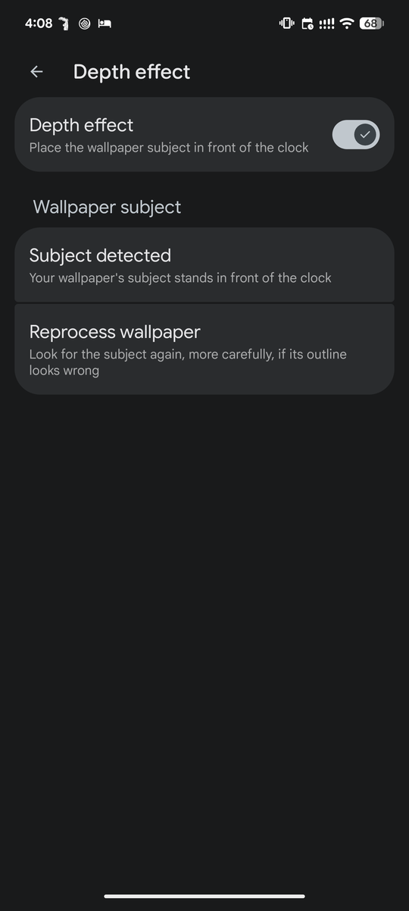
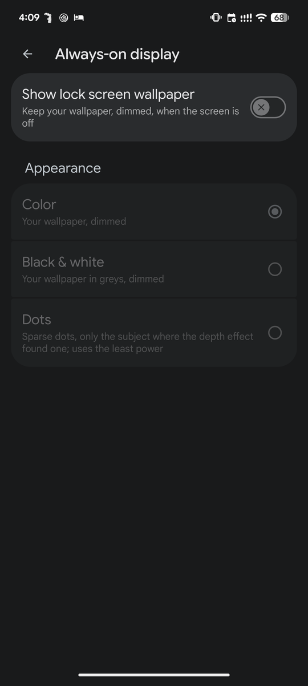
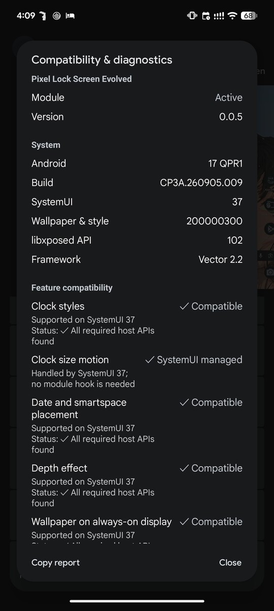

<div align="center">


# Pixel Lock Screen Evolved

**The lock screen clocks and depth effect the Android 17 Pixel does not ship — picked where you already choose one.**

Wallpaper & style → **Clock** → iOS, Stacked, Numerals, Analog or Split, beside Google's own.

<br>

[](https://github.com/MrxSiN/PixelLockScreenEvolved/releases)
[](https://github.com/MrxSiN/PixelLockScreenEvolved/releases)
[](https://developer.android.com)
[](LICENSE)

</div>

---

> [!NOTE]
> **v0.0.8 is fully compatible with the latest Android release: Android 17 QPR1
> (November 2026, `CP4A.261105.040.A1`), tested on a Pixel 8 Pro.** QPR1 moved the
> lock screen into a Compose scene and dropped a number of older clock APIs;
> every feature in this module runs on that scene, and the compatibility report
> in Wallpaper & style shows each hook it depends on resolving on your own build.

## Why it works this way

Most lock screen modules draw a clock over SystemUI's and hide the real one.
This one does not. Its clocks are added to SystemUI's own clock registry, the
same place Google's clocks come from, so SystemUI lays them out, dims them for
the always-on display, moves them for burn-in and previews them itself — and
Wallpaper & style lists them, previews them and stores the choice as it does
for any clock.

|  | |
|---|---|
| 🎯 **Native** | Chosen, previewed and applied in Wallpaper & style. No settings app, no second preview. |
| 🌗 **Everywhere a clock is** | The lock screen, the picker preview and the always-on display, following the wallpaper's colours. |
| 🔙 **Leaves nothing behind** | Nothing is written but the clock choice the picker itself stores. Disabling the module falls back to the default clock. |
| 🧩 **One contract** | A clock style knows nothing of SystemUI; `host/` adapts any `ClockStyle` to SystemUI's clock plugin interfaces. |
| 🛟 **Fails softly** | Every hook belongs to one feature. A feature whose host API moved switches itself off and says so; the rest keep working. Repeated crashes turn on Safe Mode rather than leaving you with a lock screen you cannot use. |

---

## Features

<details open>
<summary><b>🕘 Five clock styles</b></summary>
<br>

Each is a full Wallpaper & style clock, with Google's own **Style**, **Color**
and **Size** tabs (and a **Position** tab for the clocks that can move), its own
thumbnail in the clock list, and its own small face for when notifications
share the screen.

| Style | Large face | Small face |
|---|---|---|
| **iOS** | The date over a time on one line, set in the Pixel clock's own font (Google Sans Flex Clock, the first clock in the picker), spanning the same margins as the date and smartspace. 12-hour time without AM/PM or a leading zero; 24-hour time padded. | The same line at the stock clock's height, with Pixel's date and weather row below. |
| **Stacked** | Hour over minute, flush to the start of the screen, date below. | One line. |
| **Numerals** | Giant Roboto Flex figures whose minute grows heavier and wider as the hour passes. | One line. |
| **Analog** | A dial with rounded hands, the date below. Its ticks fade and its hands go to outline on the always-on display. | A small dial. |
| **Split** | One heavy line drawn down the screen, stretched until it meets the photo's subject. | One line, taller than a Pixel small clock's. |

<table>
<tr>
<td align="center"><br><sub><b>iOS</b></sub></td>
<td align="center"><br><sub><b>Stacked</b></sub></td>
</tr>
<tr>
<td align="center"><br><sub><b>Numerals</b>: the minute is lighter and narrower than the hour</sub></td>
<td align="center"><br><sub><b>Analog</b></sub></td>
</tr>
</table>

Every large face writes its own date where its design puts it, so SystemUI's
date and weather row is left out beside it rather than shown twice.

</details>

<details open>
<summary><b>📐 Clock face width and size</b></summary>
<br>

The picker's own two sliders, in the tabs Google puts them in. Every style has
the size slider; the iOS clock has the width slider as well.

| Control | Where | What it does |
|---|---|---|
| **Clock face width** (iOS) | Clock → Style | The same seven cuts Google's flex clock steps through, read from its own presets: `wght` 200 at `wdth` 120 through to `wght` 800 at `wdth` 30, widest and lightest first. The numerals grow heavier as they narrow, so every stop keeps about the same ink on screen. |
| **Clock size** | Clock → Size | In place of the Large switch. Four steps for iOS, from the height of Google's own large clock to 2.2 times it; six for the other styles. Moving the slider alone enables Apply. |

The iOS time always spans the lock screen's text column, edge to edge with the
date and smartspace: the width cut sets how heavy the figures are, and the size
sets only how tall, so a taller size stretches the figures upward rather than
crowding the screen. Every pair of figures stands the same gap apart, and the
sliders glide the preview to each step.

<table>
<tr>
<td align="center"><br><sub>iOS at the first width stop: <code>wght</code> 200, <code>wdth</code> 120</sub></td>
<td align="center"><br><sub>At the last width stop: <code>wght</code> 800, <code>wdth</code> 30</sub></td>
</tr>
<tr>
<td align="center"><br><sub>The smallest size: Google's own clock height</sub></td>
<td align="center"><br><sub>The largest size, behind the depth effect's subject</sub></td>
</tr>
<tr>
<td align="center"><br><sub>Clock → Size</sub></td>
<td></td>
</tr>
</table>

</details>

<details open>
<summary><b>📍 Clock position</b></summary>
<br>

Clock → **Position**, the last tab. With **Adaptive position** on, the clock
stands where it hides least of the wallpaper's subject. Off, drag the clock in
the preview itself: it follows the finger, snaps to the top, the quarters and
the bottom, and keeps clear of the fingerprint sensor and the smartspace card.
A hint beside the preview says so. Apply stores the place as a share of the
screen, so it holds at every resolution.

<table>
<tr>
<td align="center"><br><sub>Clock → Position, Adaptive off</sub></td>
</tr>
</table>

</details>

<details open>
<summary><b>🪄 Depth effect</b></summary>
<br>

The subject of a photo wallpaper in front of the large clock, as on iOS: the
time goes behind the subject, and nothing else on the lock screen does. Where
the subject would hide more than half of the time, the time stays in front so
it can still be read. The lock screen tab of Wallpaper & style shows the effect
too; the preview of a photo not yet set does not.

Wallpaper & style → Lock screen, at the bottom:

| Setting | Where | What it does |
|---|---|---|
| **Depth effect** | Its switch, or its page | Finds the subject of the lock screen photo on the device and draws it over the time, placed exactly where the window manager puts the wallpaper and following its scroll, zoom and dimming. |
| **Reprocess wallpaper** / **Try again** | Depth effect page | Shows whether the subject was found, and looks again, more carefully (the photo and its mirror image, averaged), when the outline came out wrong or none was found. No app data needs clearing. |

The subject is found once per photo, by the module's own app, with
BiRefNet_lite on ONNX Runtime; nothing leaves the device. It takes about 12
seconds on a Pixel 8 Pro, and a **Preparing depth effect** notification shows
meanwhile — silent, with its icon in the status bar — then **Depth effect
ready** for a few seconds. A photo already seen shows its effect at once. Live
wallpapers are drawn by their own apps and have no depth effect.

<table>
<tr>
<td align="center"><br><sub>The Depth effect page</sub></td>
<td align="center"><br><sub>The subject in front of the time</sub></td>
</tr>
</table>

</details>

<details open>
<summary><b>✂️ Split: a clock that reads the photo</b></summary>
<br>

Split is drawn for the depth effect. The time is one heavy line stretched down
the lock screen until it meets the photo's subject, and a little past it, so
the subject stands in front of the ends of the numerals rather than beside
them. The subject's box is measured from the cut-out the depth effect already
made, placed exactly where the wallpaper is placed, and the face is laid out
around it again whenever the photo or its scroll changes.

A photo whose subject fills the screen from its top is a background rather than
something to stand the time above, so there the numerals reach toward the
middle of the screen instead — as they do when the depth effect is off or no
subject was found.

<table>
<tr>
<td align="center"><br><sub>Stretched to the subject</sub></td>
<td align="center"><br><sub>Beside notifications</sub></td>
<td align="center"><br><sub>On the always-on display</sub></td>
</tr>
</table>

</details>

<details open>
<summary><b>🌙 Always-on display</b></summary>
<br>

Wallpaper & style → Lock screen → **Always-on display**:

| Setting | What it does |
|---|---|
| **Show lock screen wallpaper** | Keeps the lock screen photo on the always-on display, dimmed, as on iOS. It needs **Always show time and info** on, and uses more battery than a black always-on display. |
| **Appearance**: Color, Black & white or Dots | One of three: the photo dimmed; dimmed in greys; or sparse dots on black, only the photo's subject where the depth effect found one, about 4% of pixels lit, for the least power. Each dot is lit nearly as brightly as the clock beside it, since the always-on display holds greys unsteadily. |

Going to sleep, the numerals thin along the font's weight axis rather than
fading, so few pixels stay lit, and the iOS clock is traced in outline. The
time comes out in front of the depth effect's subject first and only then gives
its place back to SystemUI's fingerprint-aware clock region, so nothing crosses
the subject midway. Everything shifts a little every minute, the photo on a
small circle and the dots through their grid, so no pixel stays lit, against
burn-in.

With notifications, the rows are spaced as SystemUI spaces its own: a small
module face is given the band the lock screen lays its own small clock out in,
so the date row and the notifications below it keep their distances.

<table>
<tr>
<td align="center"><br><sub>The Always-on display page</sub></td>
<td align="center"><br><sub>Notifications on the always-on display</sub></td>
</tr>
</table>

</details>

<details open>
<summary><b>👆 Double tap to turn off screen</b></summary>
<br>

Double tap an empty space on the lock screen to turn the screen off: the
screen goes dark as a circle closing on your finger, the reverse of a tap on
the always-on display, then shows the always-on display as usual. It is Google's own
gesture, which SystemUI already carries unfinished: the module only switches
it on from the stock `double_tap_to_sleep` setting. Taps on notifications,
media, smartspace, shortcuts or the fingerprint area stay theirs, and the
gesture is off while TalkBack's touch exploration is on. The switch sits in
**Wallpaper & style → Lock screen**; on a build where SystemUI turns the
gesture on itself, the module stays out of its way.

</details>

<details open>
<summary><b>🩺 Compatibility, diagnostics and Safe Mode</b></summary>
<br>

Wallpaper & style → Lock screen → **Compatibility & diagnostics**.

Every host class, method and field the module needs is declared up front, one
list per feature. On startup each is looked for and the result published as a
snapshot; the dialog shows, per feature, whether it is running, and which
contract moved when it is not.

| | |
|---|---|
| **Per-feature hooks** | A feature whose required contract is missing never installs its hooks. It switches itself off and logs why; clocks, the depth effect, the picker pages and smartspace placement each stand or fall alone. |
| **Verified builds** | The Android builds each feature has been run on, so a snapshot from an unverified build reads as untested rather than broken. |
| **Safe Mode** | Repeated crashes in a hooked process turn every hook off and post a notification, rather than leaving you with a lock screen or a picker you cannot use. Clearing it is one tap. |

<table>
<tr>
<td align="center"><br><sub>On Android 17 QPR1: every feature compatible</sub></td>
</tr>
</table>

</details>

---

## Supported versions

| Build | Android | Device | Status |
|---|---|---|---|
| `CP4A.261105.040.A1` | 17 QPR1 (November 2026) | Pixel 8 Pro | Verified; every contract checked in CI, three renamed members located with DexKit |
| `CP3A.261005.005` | 17 QPR1 (October 2026) | Pixel 8 Pro | Verified; every contract checked in CI |
| `CP3A.260905.009` | 17 QPR1 (September 2026) | Pixel 8 Pro | Verified; recorded before the double tap contracts |
| `CP2A.260805.005` | 17 (August 2026) | Pixel 8 Pro | Verified before build descriptions were recorded |

Any other build still runs: each feature is checked against the host on start.
A host member that monthly builds tend to rename (a numbered Kotlin lambda, a
rewritten method) is found again by what it is, with DexKit, once per build.
A feature whose host API moved beyond that switches itself off and says so in
**Compatibility & diagnostics** while the rest keep working.

Known limits:

- Live wallpapers are drawn by their own apps, so they have no depth effect.
- Finding a subject takes about 12 seconds per new photo, once.

## Requirements

| | |
|---|---|
| **Android** | 17 QPR1 (API 37) on a Pixel |
| **Apps** | System UI (`com.android.systemui`) and Wallpaper & style (`com.google.android.apps.wallpaper`) |
| **Framework** | [Vector](https://github.com/JingMatrix/Vector) v2.2+, or any framework implementing libxposed API 102+ |
| **Root** | Only what the framework itself needs |

Built against the modern [libxposed API](https://github.com/libxposed/api)
(`io.github.libxposed:api`), not the legacy `de.robv.android.xposed` bridge.

## Install

```
1. Install the APK from Releases
2. Enable Pixel Lock Screen Evolved in your Xposed manager
3. Restart System UI and force-stop Wallpaper & style once
4. Wallpaper & style → Clock → choose a clock (iOS, Stacked, Numerals, Analog or Split) → Apply
5. Optional: Wallpaper & style → Lock screen → Depth effect
```

The module declares a **static scope**, so there is nothing to pick. It has no
icon in the app drawer and no screen of its own: every control is in Wallpaper
& style.

## Recovery

- **Crash loop:** three crashes of System UI or Wallpaper & style within a
  minute turn on Safe Mode, which holds the module's features off in that
  process and posts a notification. Restore them from the notification or from
  **Compatibility & diagnostics** once the cause is fixed.
- **One feature misbehaving:** a feature whose hooks keep failing stops alone;
  the compatibility page shows it as faulted.
- **Anything else:** disable the module in your Xposed manager and restart
  System UI. The lock screen falls back to the default clock; nothing else was
  written but the clock choice the picker itself stores.

## Under the hood

Clocks are added to SystemUI's own clock registry, so the system lays them out,
themes and previews them. Every host member a feature needs is declared as a
contract, checked on the phone before anything installs, and checked in CI
against a recorded description of each verified Pixel build.

- [Architecture](docs/architecture.md): the clock registry path, contracts and
  host compatibility tests, package layout, building
- [Android 17 QPR1](docs/android-17-qpr1.md): the Compose lock screen port
- [Depth effect](docs/depth-effect.md): segmentation, job coalescing and the
  exported service's threat model
- `HOOK_NOTES.md`: every host signature and how it was verified

---

<div align="center">

**GNU General Public License v3.0** · see [`LICENSE`](LICENSE) and [`NOTICE.md`](NOTICE.md)

</div>
